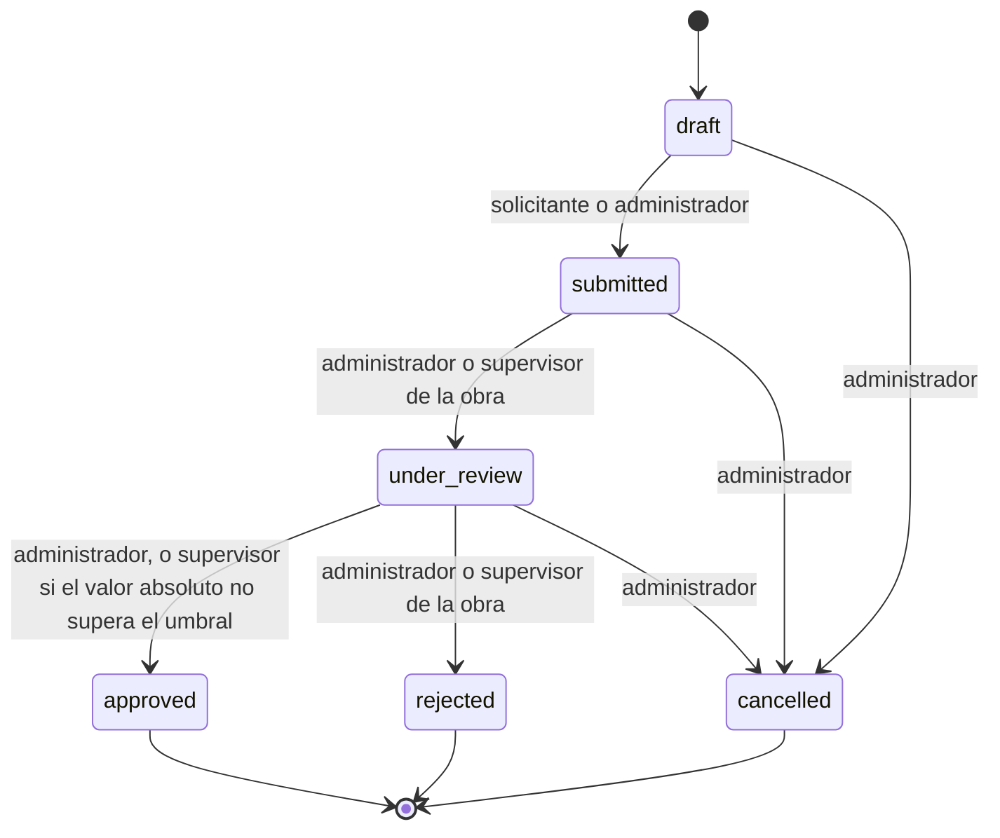

# Logística de Obra

Aplicación interna para una constructora en Nueva York. La Fase 0 entrega autenticación, alta de cuentas internas, panel de obras y el esquema para desarrollar los módulos de logística.

## Estado del proyecto

Las fases 0 a 5 están cerradas en código y en `main`. Los pull requests [#1](https://github.com/leranuva/app_team_BD/pull/1) (CI y guías de despliegue) y [#2](https://github.com/leranuva/app_team_BD/pull/2) (portal de campo, corrección de asistencia y reportes) ya están mergeados. El CI de ese árbol pasó en [44984661715](https://github.com/leranuva/app_team_BD/actions/runs/44984661715).

Sigue pendiente:

- Aprobación de horas: no existe `approved_by_supervisor_at`. `/supervisor/hours` no aprueba.
- No hay Service Worker ni Background Sync. El fichaje pendiente solo se envía con la página abierta.
- No hay miniatura derivada: `url` y `thumbnail_url` firman el mismo archivo.
- No hay página React de la obra. El detalle sigue en Filament.
- Falta el pase manual de la Fase 4 y del Bloque A de la Fase 5 (30–40 minutos, GPS en un móvil real).
- El costo de materiales en el PDF depende de `unit_cost_cents` cargado a mano, y el presupuesto es por obra (`job_sites.base_budget`), no por alcance.
- El aviso de runtime Node 20 en las actions quedó resuelto: `checkout`, `setup-node` y `cache` van en v5 (Node 24). La aplicación se compila con Node 20.

## Arranque

Requisitos: PHP 8.3 con PDO PostgreSQL, intl, mbstring y zip, Composer 2, Node.js 22.12+ y PostgreSQL 16. Crea una base vacía y un usuario con permisos sobre ella. Desde la raíz del proyecto:

~~~powershell
composer install
Copy-Item .env.example .env
# Completa DB_HOST, DB_PORT, DB_DATABASE, DB_USERNAME y DB_PASSWORD en .env.
php artisan key:generate
php artisan migrate --seed
npm ci
npm run build
php artisan logistics:create-worker
php artisan serve
~~~

Usa el comando de alta para crear el primer **Super Admin**. La contraseña se captura de forma interactiva. Abre [el panel administrativo](http://127.0.0.1:8000/admin) o [el portal operativo](http://127.0.0.1:8000/dashboard).

Ejecuta de nuevo el comando para crear supervisores y trabajadores. Desde **Obras**, un administrador puede crear una obra y guardar su **Equipo asignado**. Para probar con SQLite en local, establece DB_CONNECTION=sqlite, elimina DB_DATABASE y crea database/database.sqlite antes de migrar.

### Configuración del entorno

- En producción usa HTTPS en el servidor o proxy, APP_URL con https, APP_DEBUG=false y SESSION_SECURE_COOKIE=true. Configura SMTP para la recuperación de contraseñas. El login de Breeze limita intentos por correo e IP y el de Filament aplica su propio límite.
- `APP_TIMEZONE=America/New_York` define la zona operativa en `config('app.business_timezone')`. El portal usa ese valor para mostrar los turnos. Laravel y la sesión PostgreSQL usan UTC para persistir instantes. Para la Fase 1, calcula los límites de semana laboral en la zona operativa y conviértelos a UTC para consultar y medir intervalos, incluidos los cambios de horario de verano.
- El disco S3 está disponible con las variables AWS de .env.example. Usa un bucket privado y credenciales fuera del repositorio. La subida de documentos se incorpora en los respectivos módulos.
- La cola usa la base de datos. Para consumir trabajos, ejecuta php artisan queue:work. Las fases de órdenes de cambio y reportes añadirán sus trabajos.
- Conserva APP_KEY al desplegar o actualizar. Los datos del seguro y del contacto de emergencia están cifrados con esa clave.

## Acceso

### Trabajadores

En `/admin/workers`, los administradores pueden dar de alta, editar, activar, desactivar y eliminar perfiles operativos. Cada perfil utiliza su registro de `User`. Elegir la obra principal también añade al trabajador a su equipo y conserva sus demás membresías. Los supervisores pueden actualizar únicamente el teléfono, la dirección y el contacto de emergencia de los trabajadores de su equipo. La eliminación es lógica para conservar las referencias históricas. Una cuenta inactiva pierde el acceso en la siguiente solicitud.

Las membresías se guardan en `job_site_user`. La semántica de `is_primary` se representa con `users.primary_job_site_id`: cada trabajador tiene cero o una obra principal. El guardado actualiza esa FK y añade la membresía en la misma transacción. Cambiar de obra principal conserva la membresía anterior. Para seleccionar trabajadores asignables, usa `User::operational()->active()` y aplica también el filtro de obra.

Configura las variables AWS del disco privado S3 para cargar documentos de identidad y certificaciones OSHA. Conserva bloqueado el acceso público al bucket. Filament guarda rutas generadas y solo firma documentos asociados al perfil cuando el usuario está autorizado. Los enlaces de S3 caducan a los 10 minutos. Los archivos se conservan al eliminar registros o quitar adjuntos para que la retención de documentación se gestione por separado. Las pruebas usan un disco S3 simulado.

`php artisan db:seed --class=ExampleWorkersSeeder` crea una obra y tres perfiles operativos ficticios en local. Los ejemplos tienen contraseñas aleatorias y sirven para probar el panel desde una cuenta administrativa.

| Rol | Acceso en la Fase 0 |
| --- | --- |
| Super Admin | Todas las obras, operaciones y gestión de roles en Shield. |
| Administrador | Todas las obras, sus equipos y asignaciones. |
| Supervisor | Consulta de sus obras en Filament y de sus turnos y listas en el portal. Las policies autorizan la consulta de su equipo y registros de sus obras. |
| Carpintero y Ayudante | Portal operativo con sus propios turnos y listas pendientes en las obras de las que sean miembros. |

El registro público está deshabilitado. Los cinco roles base se aprovisionan mediante un seeder idempotente y se protegen de cambios desde Shield. La pertenencia a una obra se controla mediante job_site_user. Los modelos ligados a obras aplican un scope global para sesiones autenticadas. Las policies comprueban el acceso a cada registro. Los procesos sin sesión deben consultar con visibleTo($actor) cuando actúan por cuenta de un usuario. Los comandos de mantenimiento operan a nivel de base de datos.

Shield gestiona roles y permisos administrativos. La generación automática de policies y el registro de la policy de roles de Shield están desactivados. Para generar permisos CRUD, usa `php artisan shield:generate --panel=admin --option=permissions` y selecciona el recurso correspondiente. Las policies de Laravel conservan la autorización de registros y acciones de negocio. En Fase 1, registra la policy de fichaje explícitamente si reemplaza la policy de lectura actual de `Attendance`.

## Estructura

### Turnos en Filament

El recurso `/admin/shifts` permite crear, editar, duplicar y cancelar turnos. El formulario muestra la hora de Nueva York y guarda los instantes en UTC. Usa las columnas existentes `user_id`, `starts_at` y `ends_at`. La migración complementaria añade el alcance opcional, el rol operativo, el estado, las notas y los datos de auditoría.

El trabajador debe estar activo y tener el rol requerido y una membresía en la obra. La validación de solapamientos cubre todas sus obras, admite rangos contiguos y excluye turnos cancelados o eliminados. PostgreSQL bloquea la fila del trabajador durante la asignación para serializar cambios simultáneos. La asignación múltiple confirma cada turno por separado e informa el resultado por trabajador.

Cancelar exige un motivo y lo registra en la bitácora `shifts`. Administrador y Super Admin pueden eliminar lógicamente un turno sin asistencia. Para ejecutar las pruebas de este recurso, usa `php artisan test --filter=ShiftManagementTest` o la suite completa con `php artisan test`.

### API de turnos

La API usa la sesión web con Sanctum. Desde el portal, envía las cookies, `Accept: application/json` y el token CSRF en solicitudes de escritura.

- `GET /api/shifts/options` devuelve `job_sites` como pares `{ id, name }`, `statuses` y `roles` como pares `{ value, label }` y `can_edit` según la policy de turnos. Para los trabajadores, las obras incluyen su obra principal y sus demás membresías vigentes. El endpoint exige sesión y tiene una cuota independiente de 120 solicitudes por minuto.

- `GET /api/shifts` devuelve `{ data: [...], meta: { from, to, count } }` según el rol y la obra. Requiere `from` y `to` en ISO 8601. Los filtros opcionales son `job_site_id`, `worker_id`, `role_required` y `status`. El rango incluye turnos que lo intersectan y usa un límite final exclusivo. Una fecha sin hora representa la medianoche en la zona operativa. El intervalo puede cubrir hasta 90 días locales y devolver hasta 2.000 turnos sin paginación.
- El GET devuelve 200 al consultar, 403 si se solicita un filtro fuera de los permisos del usuario, 422 por rango inválido o exceso de resultados y 429 después de 60 solicitudes por minuto.
- `PATCH /api/shifts/{id}/reassign` exige `{ start_at, end_at, expected_updated_at }` con timestamps ISO 8601 y offset explícito, incluido `Z`. Usa como `expected_updated_at` el valor `updated_at` del evento leído. `data` y `current` contienen eventos completos en el mismo formato que el GET.
- La consulta mapea las columnas `starts_at` y `ends_at` a `start` y `end` para FullCalendar. El cuerpo de escritura usa `start_at` y `end_at`. El offset identifica el instante exacto al cruzar zonas horarias y cambia según la fecha en Nueva York. Los valores se guardan en UTC.
- La reasignación bloquea el trabajador y el turno, en ese orden, y compara la versión antes de guardar. Comparte la regla de solapamiento con Filament y registra los cambios en `shifts`. `updated_at` avanza al menos un segundo por cada actualización del modelo para distinguir arrastres rápidos con la precisión de la columna existente.
- El PATCH tiene una cuota independiente de 120 solicitudes por minuto. Alcanzar la cuota devuelve 429.
- Después de confirmar un cambio real, se encolan una notificación de base de datos y un correo al trabajador, excepto cuando es quien hizo el cambio. Incluyen la obra, los horarios anterior y nuevo en Nueva York y el nombre del editor. Un PATCH con la versión vigente y el mismo horario devuelve 200, conserva la versión y omite la auditoría y la notificación. Ejecuta `php artisan queue:work` y configura SMTP para procesar los avisos.

| Código PATCH | Resultado |
| --- | --- |
| 200 | `{ data, message }` |
| 403 | El usuario carece de permiso para reasignar el turno. |
| 409 | Versión obsoleta. `{ message, current }` contiene el evento vigente. |
| 422 | Datos inválidos o solapamiento en `errors.start_at`. |
| 429 | Se alcanzó la cuota independiente de 120 solicitudes por minuto. |

### Calendario de turnos

`/shifts/calendar` carga por Inertia el mismo catálogo que el endpoint de opciones, el permiso de edición y la zona de Nueva York. FullCalendar 6 con el adaptador Luxon muestra los turnos en mes, semana o lista. Los filtros de obra, rol y estado se inicializan desde la URL y actualizan `job_site_id`, `role_required` y `status` sin volver a navegar. La página también admite `worker_id` en un enlace compartido. Para agregar otro filtro, añade su clave al estado de la página y aplica el mismo criterio en la consulta del backend.

La fuente de eventos de FullCalendar pasa el rango visible a `useShiftsFeed`. El hook precarga siete días a cada lado, agrupa cambios durante 300 ms, cancela consultas obsoletas y guarda cada combinación de rango y filtros por 60 segundos. Un 422 en el rango ampliado reintenta una vez con el rango visible. Un 429 respeta `Retry-After` cuando el servidor lo envía. La paleta de `resources/js/features/shifts/shiftColors.ts` define fondo, borde y texto para cada estado: índigo para programados, verde para confirmados, azul para completados y gris atenuado con tachado para cancelados. El tooltip nativo muestra el trabajador, la obra y el rol.

El servidor decide el permiso general `can_edit` y el permiso por turno `extendedProps.can_edit`. La interfaz refleja ambos. La página detecta el puntero táctil al montar y abre directamente el formulario de horario al tocar un turno editable, para evitar arrastres involuntarios. En escritorio también se puede editar desde el detalle con el teclado. Ante un 409, la página sustituye el evento por `current`, incluida la versión que usará el próximo intento.

#### Calendario: edición y fallback táctil

Sonner muestra los avisos del calendario y del formulario. El formulario usa campos nativos `datetime-local` y convierte la hora de Nueva York a ISO 8601 con Luxon. Si el servidor devuelve 409 durante la edición, el modal sigue abierto con el horario y la versión vigentes. El diálogo de Headless UI contiene el foco y se cierra con Escape.

| Resultado de edición | Aviso y comportamiento |
| --- | --- |
| 200 | «Turno reasignado». Se aplica la respuesta y se vuelve a consultar el rango activo. |
| 409 | «Otro usuario modificó el turno; se actualizó la vista». Se aplican el horario y la versión de `current`. |
| 422 | Se muestra el primer error de validación. En escritorio se revierte el arrastre o el ajuste de duración. |
| 403 | «Sin permisos para reasignar este turno». Se revierte el gesto. |
| 429 | «Demasiadas operaciones, espera un momento». Se revierte el gesto. |
| Error de red | Se revierte el gesto y se ofrece «Reintentar». En el modal se puede volver a enviar el formulario. |

Ejecuta `npm test` para probar el calendario con Vitest y Testing Library. Para comprobarlo en un navegador, abre Turnos como supervisor, arrastra un turno y confirma el nuevo horario. Abre el mismo turno en dos pestañas, guarda en una y luego arrástralo en la otra para comprobar que la segunda muestra el horario vigente. Con emulación táctil, toca el turno y confirma que el formulario permite editar inicio y fin.

Evento de ejemplo en `data`:

~~~json
{
  "id": 1,
  "title": "Carlos Méndez · Carpintero",
  "start": "2026-11-21T08:00:00-05:00",
  "end": "2026-11-21T17:00:00-05:00",
  "updated_at": "2026-11-20T16:42:00-05:00",
  "status": "programmed",
  "role_required": "carpintero",
  "job_site": {"id": 3, "name": "Brooklyn Heights Renovation", "address": "Brooklyn, NY"},
  "job_scope": {"id": 7, "name": "Encofrado"},
  "worker": {"id": 12, "name": "Carlos Méndez", "role": "carpintero"},
  "extendedProps": {
    "worker_name": "Carlos Méndez",
    "job_site_name": "Brooklyn Heights Renovation",
    "role_required": "carpintero",
    "status": "programmed",
    "can_edit": true
  }
}
~~~

- **Laravel 12 y Breeze** comparten la sesión web con React e Inertia. Las rutas de dominio de esta fase son web.
- **Filament 4 y Shield** exponen el panel en /admin. Filament valida sus propios formularios, autoriza con policies y guarda la obra y su equipo en una transacción. El perfil web conserva el Form Request de Breeze.
- **Eloquent y PostgreSQL** cubren trabajadores, obras, scopes, órdenes de cambio, materiales, listas, turnos y asistencias. Las claves foráneas compuestas previenen cruces de obra en scopes y listas, y garantizan que la asistencia pertenezca al turno, trabajador y obra indicados.
- **Spatie Activitylog** registra cambios de modelos en órdenes de cambio, turnos, catálogo y listas de materiales. En una actualización autenticada, `causer` identifica al usuario, `subject` al modelo modificado y `LogOptions` limita el historial a los campos configurados que cambiaron. El valor anterior queda en `properties.old` y el nuevo en `properties.attributes`. Las actualizaciones masivas con el constructor de consultas omiten los eventos de modelo.
- El catálogo es global. El acceso de campo a los materiales se concede a través de las listas asignadas. Los datos privados de trabajadores quedan fuera de la serialización del usuario.

## Verificación

### Fotos de avance de obra

La migración `scope_photos` vincula cada foto con un alcance y un usuario. El modelo deriva la obra del alcance y una clave foránea compuesta comprueba esa relación en la base. En SQLite, Laravel activa `PRAGMA foreign_keys` al abrir la conexión mediante `DB_FOREIGN_KEYS=true` por defecto.

`ScopePhoto::temporaryUrl()` firma durante 15 minutos las fotos activas que existen en el disco privado. La ruta relativa no se incluye al serializar el modelo. `php artisan test --filter=ScopePhotoModelTest` comprueba la reversión y reaplicación de la migración, el vínculo con la obra y la expiración de los enlaces con `Storage::fake('s3')`.

#### ScopePhotoService: reglas de negocio

El observer permite actualizar `caption` y `archived_at` y protege los demás metadatos tras crear la foto. `ScopePhotoService` permite a administradores y supervisores de la obra subir JPEG, PNG o WebP de hasta 10 MB. El servicio ignora `job_site_id` en los metadatos recibidos y siempre lo deriva del alcance. Escribe con visibilidad privada en `scopes/{obra}/{alcance}/{uuid}.{ext}`, consulta el tamaño en S3 y conserva el nombre original por separado. Si falla la escritura o el registro en la base, intenta eliminar el objeto de esa subida. La fecha de captura usa primero el dato explícito, después el EXIF del JPEG si PHP puede leerlo y finalmente la hora del servidor. El EXIF sin offset se interpreta en Nueva York.

#### Archivado y restauración de fotos

El archivado conserva el objeto en S3 y evita emitir enlaces nuevos. Los enlaces ya emitidos pueden seguir funcionando hasta expirar. Al repetir un archivado se conservan `archived_at` y el motivo original. Al repetir una restauración de una foto activa se conserva su estado. Las repeticiones omiten una segunda entrada en la bitácora.

`LogsActivity` guarda una sola actualización por cambio, con descripción `scope_photo.archived` o `scope_photo.restored` y el actor en `causer`. El motivo es opcional en el servicio y se guarda en `properties.reason` al archivar. Filament y la API lo envían con un máximo de 500 caracteres.

Antes de restaurar, el servicio comprueba que el objeto siga en S3. Si se borró manualmente o por una política de retención, la foto sigue archivada y el log de la aplicación registra `photo_id` y `path` como advertencia. Las pruebas usan `Storage::fake('s3')`, que admite `exists()`, `delete()` y las comprobaciones `assertExists()` y `assertMissing()`.

`updateCaption()` permite corregir la descripción, que es el otro campo mutable. Recorta el texto, trata el vacío como `null` y no escribe ni audita si no hubo cambio. La galería de esta fase no expone esa edición.

### Fotos de avance: Filament, API y galería React

La policy se descubre sola: `App\Policies\ScopePhotoPolicy` corresponde a `App\Models\ScopePhoto`. No hay `AuthServiceProvider`. La membresía del supervisor está en la tabla `job_site_user`. Carpintero y Ayudante no consultan fotos. Nadie puede borrarlas; solo se archivan y se restauran.

| Rol | Ver, crear, archivar y restaurar |
| --- | --- |
| Super Admin y Administrador | Todas las obras. |
| Supervisor | Solo las obras en las que tiene membresía. |
| Carpintero y Ayudante | Sin acceso. Queda para una iteración posterior si se les da consulta. |

### FileUpload y ScopePhotoService

El formulario de Filament usa `FileUpload` con `disk('s3')`, `visibility('private')`, `preventFilePathTampering()` y `storeFiles(false)`. Filament no guarda el archivo ni escribe la ruta en el modelo. La acción `uploadPhoto` recibe el `TemporaryUploadedFile` y llama a `ScopePhotoService::store()`. El servicio valida el MIME real, genera `scopes/{obra}/{alcance}/{uuid}.{ext}`, lee `size_bytes` desde S3 y borra el objeto si la base no confirma la fila. Archivar y restaurar también pasan por el servicio, no por `update()`.

Mientras el formulario no se envía, Livewire guarda el archivo temporal en el disco por defecto, que aquí es `local`, dentro de `storage/app/private/livewire-tmp`. La aplicación no publica `config/livewire.php`, así que vale el ajuste del paquete: `temporary_file_upload.cleanup` está en `true`. Al montar un componente con subida de archivos, Livewire borra temporales de ese directorio con más de 24 horas. Quitar el archivo del campo lo elimina en ese momento. `php artisan livewire:configure-s3-upload-cleanup` no aplica: ese comando exige que el disco temporal sea S3 y configura una regla de ciclo de vida del bucket. El temporal de este proyecto no está en S3.

### API

La sesión es la de Sanctum. `url` y `thumbnail_url` se firman 15 minutos dentro de `ScopePhotoResource` y no se guardan. No hay miniatura derivada: las dos claves usan la misma firma. Si la foto está archivada, ambas son `null`. El JSON no incluye `path`. `can_archive` y `can_restore` salen de la policy y del estado de archivo, igual que `extendedProps.can_edit` en el calendario.

Usar la imagen completa como miniatura es la decisión de esta fase, no un fallo. Si un alcance acumula cientos de fotos, el navegador descargará el original para cada celda. La evolución natural es generar una miniatura real con un job y Imagick, y firmar esa ruta en `thumbnail_url`.

- `GET /api/job-scopes/{scope}/photos?status=active|archived|all&page=` autoriza `viewAny` sobre ese alcance. Devuelve 20 por página, activas por defecto, ordenadas por `created_at` descendente. La cuota es de 60 por minuto.
- `POST /api/job-scopes/{scope}/photos` recibe `file`, `caption`, `lat`, `lng` y `taken_at`. Responde 201. La cuota de escritura, compartida con archivar y restaurar, es de 30 por minuto.
- `PATCH /api/scope-photos/{photo}/archive` acepta `reason` opcional. `PATCH /api/scope-photos/{photo}/restore` responde 200, o 422 con el mensaje «El archivo original ya no está disponible» si el objeto ya no está en S3.
- Un alcance o una foto que el usuario no puede ver responde 403. Un identificador inexistente responde 404.

`/job-scopes/{scope}` renderiza la galería. Las pestañas son Activas y Archivadas; Todas solo aparece con acceso global. «Cargar más» pide la página siguiente. El modal de detalle atrapa el foco y se cierra con Escape. El de subida muestra el avance y deshabilita el envío mientras dura.

| Respuesta | Aviso |
| --- | --- |
| 201 | «Foto subida» y la miniatura entra en la pestaña activa. |
| 422 al subir | El primer error del backend, por ejemplo el tamaño o el tipo. |
| 403 | «Sin permisos». |
| 200 al archivar | «Foto archivada». Sale de Activas y queda en Archivadas. |
| 200 al restaurar | «Foto restaurada». El movimiento es el inverso. |
| 422 al restaurar | «El archivo original ya no está disponible». |

En el dashboard, un supervisor con un alcance `active`, `in_progress` o `pending` ve «Ver fotos del alcance» y el conteo de fotos activas. Se prefiere `active`, después `in_progress` y al final `pending`. Un alcance `completed` queda fuera: el supervisor ya no sube fotos de un alcance cerrado. Si más adelante hacen falta fotos de cierre, basta con añadir ese estado a la consulta.

#### Verificación manual

El 21 de noviembre de 2026 se abrió la galería en el navegador con `php artisan serve` y un supervisor de la obra. Esta máquina no tiene credenciales AWS, así que el disco `s3` se apuntó solo durante la prueba a un directorio local privado con URLs firmadas y se restauró la configuración S3 al terminar. Los objetos de prueba se borraron después.

- El dashboard mostró «Ver fotos del alcance» hacia el alcance `active` y no hacia otro alcance `completed` de la misma obra.
- El supervisor vio las pestañas Activas y Archivadas, sin Todas.
- Tres JPEG se enviaron como `multipart/form-data` y respondieron 201. La vista previa local cargó. La barra de progreso pasó de 0 a 100 y apareció el aviso «Foto subida».
- Las tres miniaturas cargaron desde la URL firmada. `url` y `thumbnail_url` coincidían.
- El modal abrió con `aria-modal="true"`, la descripción, la hora de Nueva York y el autor. Escape lo cerró.
- Archivar respondió 200, sacó la foto de Activas y la mostró en Archivadas sin imagen. Restaurar respondió 200 y la devolvió a Activas.
- Tras borrar el objeto del bucket y archivarla de nuevo, restaurar respondió 422 y el aviso fue «El archivo original ya no está disponible». La foto siguió archivada.

Ejecuta `php artisan test --filter=ScopePhoto`, `npm test` y `npm run build`.

### Obras y alcances

La obra conserva las columnas de la fase anterior: `client`, `latitude`, `longitude` y `geofence_meters`. La API las expone como `client_name`, `lat`, `lng` y `geofence_radius_m`. El estado guardado sigue siendo `planned` (el valor por defecto de la migración), junto con `active`, `on_hold`, `completed` y `cancelled`. No se usa `planning` para no partir el dato ya almacenado. La obra principal del trabajador sigue en `users.primary_job_site_id`; `job_site_user` no tiene `is_primary`.

La geocodificación es manual. El detalle de Filament dibuja el pin y el círculo del radio con Leaflet 1.9.4 y teselas de OpenStreetMap, sin clave de API. «Ver en mapa externo» abre Google Maps con las coordenadas. El formulario acepta un radio de 50 a 500 metros; el valor por defecto sigue siendo 150. El fichaje continúa leyendo `geofence_meters`.

| Rol | Filament obras | API `GET /api/job-sites` | Filament alcances | API `GET /api/job-scopes` |
| --- | --- | --- | --- | --- |
| Super Admin y Administrador | CRUD. | Todas. | CRUD. El borrado es lógico. | Todas. `can_edit` verdadero. |
| Supervisor | Solo consulta de sus obras. | Sus obras, por `job_site_user`. | CRUD de los alcances de sus obras, sin borrar. | Esos alcances. `can_edit` verdadero. |
| Carpintero y Ayudante | Sin acceso. | Obras con un turno propio programado o confirmado que aún no terminó. | Sin acceso. | Alcances de esas obras. `can_edit` falso. |

`Editar` en `/job-scopes/{scope}` abre el formulario de Filament. El formulario no se duplica en React. Las fechas y las notas son columnas nuevas y opcionales. El avance al 100 % solo se guarda si el estado es `completed`. El responsable es un usuario con rol Supervisor y membresía en la obra. Duplicar un alcance crea otra fila en la misma obra, pendiente y sin fotos ni turnos.

En el dashboard, «Mis obras» lista las obras del supervisor con alcances y fotos activas. Para carpintero y ayudante la misma sección es de solo lectura y sale de sus turnos futuros. Un alcance `completed` sigue fuera del enlace de fotos.

### Asistencias y horas

`AttendanceService` abre y cierra asistencias del propio trabajador. Usa la hora del servidor en UTC y puede rechazar muestras GPS vencidas. Valida el radio de la obra y marca para revisión los fichajes dentro del radio con precisión superior a 100 m. Las ventanas de entrada y salida, de 30 minutos respecto del horario previsto, se ajustan en `config/attendance.php`; se pueden desactivar por separado con `null`. La base permite una asistencia por turno y una entrada abierta por trabajador. La bitácora identifica al actor y registra horarios, indicadores y totales de minutos.

`AttendanceCalculatorService` separa períodos al cruzar medianoche o el comienzo de semana en Nueva York, mide el tiempo real en UTC y suma las horas del trabajador en todas sus obras. La configuración inicial usa semana desde el lunes, 40 horas semanales, un umbral diario interno de 8 horas, overtime a 1,5× y doble tiempo desactivado. Cada minuto se asigna a una sola categoría. `estimateGrossPay()` estima el importe bruto con una tarifa suministrada.

El umbral semanal general y las reglas de obras públicas se deben contrastar con los requisitos del proyecto y del oficio antes de usar estos totales en nómina. [Jornadas y salarios de NY](https://dol.ny.gov/wages-and-hours-frequently-asked-questions) · [Artículo 8 y obra pública](https://dol.ny.gov/article-8-frequently-asked-questions)

Aplica la migración con `php artisan migrate`. Ejecuta `php artisan test --filter=Attendance` para validar fichaje y overtime.

En **Operaciones**, el botón de fichaje pide permiso de ubicación al pulsarlo. El navegador necesita HTTPS o localhost. El panel presenta los turnos propios disponibles y prioriza cerrar una entrada abierta.

`POST /api/attendances/clock-in` y `POST /api/attendances/clock-out` requieren sesión Sanctum, CSRF y un cuerpo `{ shift_id, lat, lng, accuracy, timestamp }`. El timestamp ISO 8601 con offset indica cuándo se tomó la muestra GPS. Los dos endpoints comparten 20 solicitudes por minuto. La entrada devuelve 201 y la salida 200; ambas devuelven `{ data, message }` con horarios de Nueva York y sin coordenadas. Un turno ajeno devuelve 403 y los datos inválidos o un fichaje fuera del radio devuelven 422.

Un intento fuera del radio encola avisos de base de datos y correo para supervisores activos asignados a la obra. Se envía como máximo un aviso cada cinco minutos por trabajador, turno y tipo de fichaje. El aviso identifica la obra, el trabajador y la hora del intento. No incluye coordenadas. Ejecuta `php artisan queue:work` y configura SMTP para procesar los avisos.

~~~powershell
php artisan test
npm run build
~~~

`phpunit.xml` y `.env.testing` seleccionan PostgreSQL. GitHub Actions ejecuta la suite con un servicio PostgreSQL 16 y compila los recursos de React. Para la misma ejecución en local, crea `constructora_testing` y proporciona las credenciales de esa **base exclusiva de pruebas** mediante variables de proceso. `RefreshDatabase` puede borrar sus tablas. La clave de `.env.testing` es un valor público de pruebas.

Para una ejecución rápida local con SQLite en memoria, abre una sesión de PowerShell y ejecuta:

~~~powershell
$env:DB_CONNECTION = 'sqlite'
$env:DB_DATABASE = ':memory:'
php artisan test
Remove-Item Env:DB_CONNECTION, Env:DB_DATABASE
~~~

Las migraciones de la Fase 0 usan `json()`, que produce `json` nativo en PostgreSQL y `text` en SQLite. Los adjuntos de trabajadores usan `jsonb()` para permitir la comparación que necesita el selector de equipos al consultar usuarios con `DISTINCT`. SQLite también representa esas columnas como texto. PostgreSQL aplica precisión decimal y tipos temporales con zona, mientras SQLite usa afinidades de tipo y guarda las fechas en la convención UTC de Laravel. Usa el resultado de PostgreSQL para validar cambios de esquema y consultas dependientes del motor.

Las pruebas cubren inicio de sesión, acceso por rol, aislamiento por obra, creación de obras con miembros, integridad de sitio y trabajador en asistencias y auditoría de turnos.

### Órdenes de cambio



Una orden aprobada no se cancela. El ajuste contrario es otra orden, con monto o días negativos. `rejected` y `cancelled` también son finales.

| Actor | Aprobar en `under_review` |
| --- | --- |
| Super Admin y Administrador | Cualquier monto. |
| Supervisor de la obra | Solo si `abs(amount_cents)` es menor o igual a `config/change_orders.php` → `supervisor_approval_threshold_cents` (500000, es decir $5,000). |
| Otro supervisor, carpintero o ayudante | No. |

`amount_cents` es un entero con signo. Un valor negativo es un crédito. El umbral compara el valor absoluto, así que un crédito de $6,000 tampoco lo aprueba el supervisor.

Una transición que el grafo no permite responde **422** con `{ message, from, to, allowed }`. Un actor que no puede ejecutar una transición sí permitida, o que no puede ver la orden, responde **403**. Un id inexistente responde **404**. No se usa 409: la orden no quedó en conflicto con otra escritura; el estado de origen no admite el destino.

`approved_change_orders_cents` y `approved_time_impact_days` en `job_scopes` y `job_sites` son caché. La fuente de verdad son las filas `change_orders` con estado `approved`. `recalculateImpact()` las vuelve a sumar y se puede ejecutar más de una vez. La caché de la obra solo incluye órdenes sin alcance; no suma las de sus alcances. `approved_adjustment` y `approved_extra_days` siguen siendo columnas anteriores y no participan en este cálculo.

El código `CO-{obra}-{año Nueva York}-{secuencia}` sale de `change_order_counters`. La creación inserta el contador del año y lo bloquea con `lockForUpdate` dentro de la transacción. SQLite no serializa ese bloqueo como PostgreSQL 16; la unicidad secuencial se prueba en los dos motores y la concurrencia real queda cubierta por el bloqueo de PostgreSQL.

Los adjuntos viven en el disco S3 privado, en `change-orders/{id}/{uuid}.ext`. La respuesta entrega `temporaryUrl` de 15 minutos y el nombre original. El `path` no sale del modelo. No hay archivado propio: el borrado lógico de la orden oculta la URL y conserva el objeto. El borrado físico en cascada solo ocurre con un `forceDelete`, reservado al administrador y sin botón en la interfaz. `ChangeOrderAttachmentService` no reutiliza `ScopePhotoService` porque las fotos tienen EXIF, geodatos y archivo; un PDF no.

El alta y la edición del borrador están en Filament (`/admin/change-orders`). React lista y muestra, y llama a la API para las transiciones. `Nuevo` abre Filament para no duplicar el formulario ni la subida. Desde el alcance, «Órdenes de cambio» abre `/change-orders?job_scope_id=`. No hay página React de la obra; el detalle sigue en Filament.

Las notificaciones de envío, revisión, aprobación y rechazo salen después de cerrar la transacción y usan `afterCommit()`. La cancelación no avisa.

### Verificación manual 21-nov-2026

Change Orders queda cerrada. La suite de referencia y el pase en navegador de esta fecha cubren el contador, el índice de asistencia, el mapa, la galería y los dos finales de una orden (aprobada y rechazada).

#### PostgreSQL 16

El repositorio no trae `docker-compose.yml`. Docker Desktop (engine 29.9.3) no estaba en marcha en el primer intento y `php artisan test` falló con conexión rechazada en `127.0.0.1:5432`. Tras arrancar el motor se usó el contenedor `constructora-pg16` (`postgres:16`, PostgreSQL 16.16), publicado en `5432`, con `POSTGRES_USER=constructora_test`, `POSTGRES_PASSWORD=postgres`, `POSTGRES_DB=constructora_testing` y `POSTGRES_HOST_AUTH_METHOD=trust`. `phpunit.xml` y `.env.testing` apuntan a ese host, base y usuario, con contraseña vacía; `trust` acepta esa contraseña. No hay PostgreSQL 16 instalado fuera de Docker. La imagen `minio/minio:latest` no se pudo descargar (acceso denegado), así que no hubo bucket S3 real.

`php artisan test` contra esa base: **128 pruebas, 1361 aserciones, 25,46 s, todas verdes**. Entran `ChangeOrder*`, `ScopePhoto*` (con `Storage::fake('s3')`, que no depende del motor) y `Attendance*`.

Concurrencia del código: un proceso padre dejó abierta la transacción con `lockForUpdate` sobre `change_order_counters` y dos procesos PHP hijos llamaron a `ChangeOrderService::create`. Al confirmar el padre, los códigos fueron `CO-121-2026-0001` y `CO-121-2026-0002`.

Índice parcial, el mismo que crea la migración de asistencias:

~~~sql
CREATE UNIQUE INDEX attendances_one_open_per_worker ON attendances (user_id) WHERE clocked_out_at IS NULL
~~~

En `constructora_testing` un segundo `INSERT` de asistencia abierta para el mismo `user_id` lo rechazó ese índice. El servicio también rechaza el segundo fichaje abierto antes de llegar a la base; el `INSERT` directo es la prueba del índice.

#### Navegador

`php artisan serve` en `http://127.0.0.1:8000`, base SQLite de la aplicación, cola `database` y correo `log`. Como no había credenciales AWS, el disco `s3` se apuntó solo durante el pase a `storage/app/private/s3` con `serve=true` y se restauró el driver AWS al terminar. Usuarios de esa base, contraseña `password`: `supervisor.verificacion@example.test` (Ana Verificación, miembro de la obra) y `admin.verificacion@example.test` (Administrador). Obra «Brooklyn Heights Verificación», 100 Clark Street, latitud 40.696011, longitud -73.993286, radio 150 m. Alcance «Encofrado verificación».

- Mapa de la obra en Filament, Leaflet con zoom 16: el círculo trae `data-radius="150"` y su caja mide 166×166 px. A esa latitud el zoom 16 equivale a unos 1,811 m/px, así que 150 m de diámetro son unos 166 px. El radio se dibuja en metros, no en grados.
- Galería `/job-scopes/3`: dos JPEG (de los dos o tres pedidos). Archivar y restaurar devolvieron la foto a Activas. Tras borrar el objeto del directorio que sustituía al bucket y volver a archivar, restaurar mostró el aviso «El archivo original ya no está disponible» y la foto siguió archivada. El controlador responde 422 con ese mensaje; la misma aserción pasó en la suite de PostgreSQL.
- Orden `CO-2-2026-0001`, «Muro de verificación», 180000 centavos y 2 días. La supervisora la creó, la envió y abrió la revisión en Filament. El administrador la aprobó. El alcance quedó con `approved_change_orders_cents = 180000` y `approved_time_impact_days = 2`. El widget del alcance mostró «Change Orders aprobadas» y «$1,800.00 · 2 días».
- Orden `CO-2-2026-0002`, «Crédito rechazado», -25000 centavos (Filament muestra $-250.00) y -1 día. El administrador la envió, abrió la revisión y la rechazó con motivo «Fuera de presupuesto». En `/change-orders/2` la línea de tiempo dice `Rechazada: 2026-11-21T17:28:36-05:00 · Fuera de presupuesto`. `php artisan queue:work --stop-when-empty` entregó `ChangeOrderRejectedNotification` al solicitante (usuario 3), con `reason` en la notificación de base de datos y «Motivo: Fuera de presupuesto» en el log de correo.
- «Nuevo» en `/change-orders` apunta a `/admin/change-orders/create`. El formulario guarda el entero en centavos: 180000 se lee como $1,800.00 y -25000 como $-250.00. El listado React pinta el mismo valor con `toFixed(2)`, sin separador de miles (`$1800.00`).

Durante el pase, el detalle React de una orden rechazada no mostraba el motivo: la entrada de la línea de tiempo llevaba `null` en el tercer campo. `resources/js/Pages/ChangeOrders/Show.tsx` ahora usa `order.rejection_reason`. `npx vitest run tests/Frontend/ChangeOrders.test.tsx` quedó en 2 pruebas verdes y `npm run build` compiló. No apareció otro defecto de producto. Los diálogos de confirmación de Filament 4 (`role="alertdialog"`) se anuncian ocultos a la automatización mientras están abiertos; el clic en el Confirm visible sí persistió el estado.

### Catálogo de materiales

El catálogo maestro sale de CWICR, el catálogo abierto de [Data-Driven Construction](https://github.com/datadrivenconstruction/openconstructionerp) (`data/catalog/cwicr_materials.csv`).

**Licencia.** CWICR se publica bajo [CC BY-NC 4.0](https://creativecommons.org/licenses/by-nc/4.0/): uso no comercial, con atribución a Data-Driven Construction y al catálogo CWICR. Si este proyecto se usa con fines comerciales hace falta la licencia comercial de DDC; CC BY-NC 4.0 no la cubre. El CSV completo está versionado en `database/data/cwicr_materials.csv`.

La tabla `materials` guarda `code`, `name`, `unit`, `category`, `is_active` y `notes`. No guarda precio, moneda ni stock: el pedido se gestiona fuera de esta aplicación. `unit` es `varchar(20)`. Alcanza para `kg`, `m3`, `m2`, `m`, `pcs`, `set`, `Sheet`, `100m`, `100m2` y `1000pcs`. Una unidad propia más larga no cabe en la columna; hay que ampliarla antes de usarla. Las categorías CWICR se almacenan como en su CSV (`Steel & Metal`, `Concrete & Cement`, `Electrical`, `Paint & Coatings`, `Wood & Timber`, `Fasteners`, `Pipes & Fittings`, `Insulation`, `Waterproofing`, `Aggregates & Earth`, `Glass & Glazing`, `General`). `Drywall` es una categoría de esta aplicación, también en `config/materials.php`, y el Select de Filament la ofrece junto con las demás.

El catálogo de placas de Nueva York está en `database/data/nyc_sheetrock_types_catalog_en.csv`. `php artisan materials:import-sheetrock` lo carga con categoría `Drywall` y unidad `Sheet`. El subtipo, el espesor, las medidas, el uso y el proveedor quedan en `notes`. `Est_Price_USD` no se guarda. Un `SKU` que ya existe se actualiza, incluidas las notas.

La migración `2026_11_21_260000_reshape_materials_catalog` conserva el `id`. Así, `material_list_items.material_id` sigue apuntando a la misma fila. Si el `sku` anterior tenía texto, `code` queda con ese valor recortado y `notes` queda `legacy_sku: X`. Si el `sku` estaba vacío, `code` es `MAT-` más diez caracteres de `sha1(name|unit|General)` y `notes` queda vacía. El precio y el stock antiguos no se copian.

`Material::withoutManualAudit()` pone en falso el flag que lee `MaterialObserver` antes de escribir en `activity_log`, y lo restaura al salir, también si la operación falla. Una actualización de catálogo dentro de ese cierre no crea filas de actividad. Una edición manual de `name`, `unit`, `category` o `is_active` sí. `MaterialImportService` escribe dentro de ese cierre.

El CSV se lee con `league/csv`, dependencia directa `^9.29` en `composer.json` (instalada 9.29.0). Esa restricción no admite 10.x: un `composer update` no cambia la API de `Reader`. La cabecera tiene que incluir `code`, `name`, `category` y `unit`. `base_price`, `min_price`, `max_price`, `currency` y el resto de columnas se ignoran. No hay `homedepot_sku`.

El catálogo completo está en `database/data/cwicr_materials.csv`, copiado de [cwicr_materials.csv](https://github.com/datadrivenconstruction/openconstructionerp/blob/main/data/catalog/cwicr_materials.csv). `database/data/cwicr_materials_sample.csv` sigue siendo el ejemplo de 10 filas que usan las pruebas.

~~~powershell
php artisan materials:import-cwicr
php artisan materials:import-cwicr database/data/cwicr_materials_sample.csv --dry-run
php artisan materials:import-cwicr --truncate --force
~~~

`--dry-run` cuenta altas, cambios y omisiones sin abrir transacción y sin escribir. `--truncate` borra `materials` antes de importar y solo corre con `--force` o con una confirmación interactiva. `--force` solo salta la pregunta; no salta la clave foránea. Sin `--force` y sin interacción, el comando termina en error y no borra nada. El borrado va en la misma transacción que la carga. No toca `material_list_items`: si una lista todavía apunta a un material, la clave foránea rechaza el borrado, la transacción se revierte y el comando dice cuántos materiales están referenciados. La salida indica eliminar esas listas o importar sin `--truncate`, para actualizar el catálogo sin borrarlo. Volver a importar el mismo CSV actualiza `name`, `unit` y `category` del `code` existente. No cambia `is_active` ni `notes`, así que un `legacy_sku` y un material desactivado sobreviven. Si el mismo `code` aparece dos veces en el archivo, gana la última fila: el CSV es la fuente de verdad. No se omite como duplicado. Una fila sin `name` se omite. Si `category` viene vacía se usa `General`; si `unit` viene vacía se usa `pcs`. Si `code` viene vacío, el código es `MAT-` más diez caracteres de `sha1(name|unit|category)`. Un `name` de más de 255, un `unit` de más de 20, un `category` de más de 100 o un `code` de más de 255 se omite y no se recorta. Cada fila así deja un `Log::warning` con la fila y el campo, y al final hay otro con el total y los `codes`. El proceso lee de 500 en 500 filas. En un terminal interactivo el comando muestra una barra de avance. `Total` en la salida es la suma de importados, actualizados y omitidos, no el conteo de la tabla.

### Catálogo de materiales — Filament

Un material que CWICR no trae se crea en Filament, en Materiales. El código se escribe una vez. La unidad y la categoría salen de la lista CWICR; «Otra» abre un texto de hasta 20 caracteres para la unidad y 100 para la categoría. Las notas admiten 2000 caracteres. Activar o desactivar en masa es una edición manual y queda en la bitácora. Eliminar pide confirmación y no procede si una lista todavía referencia el material: el aviso pide desactivarlo. La página «Importar materiales» sube un CSV y llama a `MaterialImportService` sin `--truncate`. Solo quien puede `MaterialPolicy@import` (Super Admin y Administrador) la abre. El supervisor consulta el catálogo y no lo crea. La licencia CWICR de esta misma sección sigue aplicando a ese archivo.

En el tablero, el resumen muestra el total, los activos, cuántos materiales están en alguna lista y las cinco categorías con más filas. Si el mismo `code` aparece dos veces en el CSV, gana la última fila.

### Catálogo de materiales — API de lectura

No hay endpoints de escritura. El catálogo se cambia en Filament o con `materials:import-cwicr`. Las cuatro rutas exigen `MaterialPolicy@viewAny` y admiten 60 solicitudes por minuto (`materials-read`). Carpintero y Ayudante reciben 403. Un id inexistente, para quien sí puede consultar, recibe 404.

- `GET /api/materials?category=&search=&active=1&page=&per_page=`
- `GET /api/materials/{material}`
- `GET /api/materials/categories`
- `GET /api/materials/units`

`active` vale `1` si no se envía: solo materiales activos. `active=0` devuelve solo inactivos. `active=all` devuelve todos. Otro valor responde 422. `per_page` vale 20 y no puede pasar de 100; fuera de 1–100 responde 422. El orden es `name` ascendente. Cada material incluye `notes` (`null` si está vacío) y `list_items_count`.

~~~json
{
  "data": [
    {
      "id": 1,
      "code": "MAT-0001",
      "name": "Structural steel beam",
      "unit": "kg",
      "category": "Steel & Metal",
      "is_active": true,
      "notes": null,
      "list_items_count": 0
    }
  ]
}
~~~

`/api/materials/categories` y `/api/materials/units` cuentan solo activos:

~~~json
{ "data": [{ "value": "Steel & Metal", "label": "Steel & Metal", "count": 12 }] }
~~~

El origen y la licencia CC BY-NC 4.0, con la nota de licencia comercial DDC, están en la sección anterior del catálogo CWICR.

### Listas de materiales

Una lista pertenece a un alcance. El código es `ML-{obra}-{año}-{secuencia}` y el contador usa `lockForUpdate`, igual que las órdenes de cambio. En SQLite ese bloqueo no espera a otra conexión; la secuencia se comprueba en PostgreSQL 16. El estado `pending` de la tabla original sigue existiendo para el tablero de asignaciones. Las listas nuevas no lo usan.

```text
draft --enviada por el solicitante o un admin--> submitted
submitted --aprobada por un admin, o por el supervisor de la obra si el total pedido cabe en el umbral--> approved
submitted --cancelada por el solicitante o un admin--> cancelled
approved --ordenada por un admin o el supervisor de la obra--> ordered
ordered --entrega registrada por un admin o el supervisor de la obra--> delivered
ordered --cancelada solo por un admin--> cancelled
approved --cancelada solo por un admin--> cancelled
delivered --consumo parcial--> partially_consumed
delivered --todo consumido de una vez--> consumed
partially_consumed --el resto consumido--> consumed
consumed --sin salida; haría falta una lista de ajuste-->
```

El umbral del supervisor está en `config/material_lists.php`: 250000 centavos, 2500 dólares. Si alguna línea no tiene `unit_cost_cents`, el total es null y el supervisor no puede aprobar. El consumo no se copia de la entrega: el supervisor lo escribe. `partially_consumed` queda cuando hay consumo mayor que cero y alguna línea todavía no alcanza lo entregado. `consumed` exige `consumed_quantity >= delivered_quantity` en todas las líneas. `unit_cost_cents` es un apunte opcional de la factura. Este bloque no calcula totales automáticos con él; solo lo muestra. Si falta, la pantalla dice «sin costos».

Una transición que el estado no permite responde 422, con `from`, `to` y `allowed`, igual que las órdenes de cambio. Quien no tiene permiso recibe 403. Un id que no existe recibe 404. Carpintero y Ayudante no entran a la API ni a Filament. El tablero viejo sigue mostrando una lista `pending` asignada a su usuario; eso no abre el flujo nuevo.

La lectura admite 60 solicitudes por minuto y la escritura 30. No hay endpoints de proveedor.

- `GET /api/material-lists?job_site_id=&job_scope_id=&status=`
- `POST /api/material-lists`
- `GET /api/material-lists/{list}`
- `PATCH /api/material-lists/{list}` solo en borrador
- `POST /api/material-lists/{list}/submit|approve|mark-ordered|register-delivery|register-consumption|cancel`

En React, «Nueva» abre el formulario de Filament. La ficha del alcance tiene la pestaña Materiales, que lleva al índice filtrado por ese alcance. Borrar desde la interfaz no está permitido. Un administrador puede hacer `forceDelete` si hace falta retirar el registro.

### Frontend React — mapa de navegación

Hay dos layouts. `GuestLayout` es el de Breeze y solo envuelve login, registro y recuperación de contraseña. `AppLayout` es el único layout autenticado: dashboard, calendario, órdenes, listas, ficha de alcance y perfil. `AuthenticatedLayout` se eliminó; era un alias de `AppLayout` y el nombre parecía el layout viejo de Breeze.

La página del tablero es `resources/js/Pages/Dashboard.tsx`. Si existieran `Dashboard.jsx` y `Dashboard.tsx` a la vez, `app.jsx` lanza un error en lugar de elegir uno en silencio.

`AppLayout` en escritorio es una barra lateral que se puede contraer. Por debajo de 768 px pasa a una barra inferior.

```text
Carpintero / Ayudante: Hoy, Mi semana, Historial, Dashboard, Mis turnos, Fichaje
Supervisor:            Dashboard, Equipo, Avance, Horas, Mis obras, Turnos, Change Orders, Materiales, Fotos
Administrador:         lo del supervisor + Catálogo de materiales + Filament (/admin)
```

El encabezado muestra el nombre, el rol y, si hay más de una obra, el selector de obra activa. Esa obra se guarda en `localStorage` con la clave `obra-activa`. Al cambiarla, la página actual se vuelve a pedir sin conservar el estado local y con `job_site_id` en la URL. Los enlaces de Turnos, Change Orders y Materiales también llevan ese parámetro. El calendario y los índices lo leen de la URL; si la URL no lo trae, usan la obra guardada. El formulario de filtro se actualiza cuando el servidor devuelve otro `job_site_id`.

El perfil del dashboard (`worker`, `supervisor`, `admin`) se calcula solo en `OperationsDashboardController`, con el rol de Spatie que esa petición ya cargó. No está en los props compartidos. Lo que sí va en cada respuesta Inertia es `auth.role` (el primer nombre de rol) y `auth.sites` (hasta 50 obras, id y nombre). Esa lista se guarda 60 segundos por usuario. Las pruebas vacían la caché en `Tests\TestCase` para que un id reutilizado no herede obras de otro caso.

El dashboard cambia de bloque según el perfil que manda el servidor: el trabajador ve el turno de hoy y el fichaje; el supervisor, accesos a fotos, turnos, órdenes y listas; el administrador, el conteo de obras, listas pendientes y la alerta de geocerca si el fichaje abierto la marcó. Los permisos de cada botón siguen viniendo de `can_*`.

### Manejo de errores

`apiErrorMessage` traduce la respuesta antes del toast:

| Código | Mensaje |
| --- | --- |
| 401 | Sesión expirada. Vuelve a iniciar sesión. |
| 403 | Sin permisos para esta acción. |
| 404 | El recurso ya no existe. |
| 409 | El mensaje del backend |
| 422 | El primer error de `errors`, o el mensaje del backend |
| 429 | Demasiadas solicitudes. Espera un momento. |
| 500 | Error del servidor. Intenta de nuevo. |
| Sin respuesta | Error de conexión. |

Un 401 también redirige a `/login?returnTo=` con la ruta actual. Un 429 lee `Retry-After` y lo muestra en segundos.

### Accesibilidad

Los botones de fichaje y de navegación miden al menos 48 px. Los diálogos usan el foco atrapado de Headless UI, se cierran con Escape y declaran `aria-modal`. Los filtros tienen `label`, no solo placeholder. Los badges de estado usan texto `slate-950` sobre `slate-200`. El texto de un turno cancelado es `#1F2937` sobre `#F3F4F6`. `prefers-reduced-motion` anula animaciones y transiciones. El calendario abre en `listWeek` si el ancho es menor de 768 px y mantiene `America/New_York`.

`@axe-core/react` no está instalado. Este bloque no tiene una auditoría formal de cumplimiento, así que el checklist de arriba es la verificación. Para una revisión institucional: `npm install -D axe-core @axe-core/react` y, en un test, `const { default: axe } = await import('axe-core')` sobre el contenedor renderizado.

## Experiencia de campo (trabajador)

`/worker/today`, `/worker/schedule` y `/worker/history` cubren la jornada, la semana y las últimas cuatro semanas de asistencia. La zona mostrada es `America/New_York`. Hoy reutiliza el mismo panel de fichaje del tablero: geolocalización al pulsar, entrada y salida por `POST /api/attendances/clock-in` y `clock-out`.

Los materiales de Hoy no tienen una clave hacia el turno. La página muestra ítems solo cuando el trabajador tiene una lista asignada cuyo alcance es el del turno de hoy. Si el turno no tiene alcance, o no hay ítems, esa sección no se pinta.

Deuda: vincular el ítem al turno (`shift_id` en `material_list_items`) para que el trabajador vea solo lo de su turno. Hoy la condición es la lista asignada al alcance; si esa columna llega a existir, esta consulta tiene que cambiar.

### Fichaje sin conexión

Si `navigator.onLine` es `false` al pulsar el botón, el navegador guarda en `localStorage` la clave `pending-clock-in` con `shift_id`, `timestamp`, `lat`, `lng`, `accuracy` y `direction` (`in` o `out`). El aviso es «Fichaje pendiente de sincronizar. Se enviará cuando recuperes conexión.» Al evento `online`, el mismo botón reintenta el POST. Un 422 borra el pendiente y pide contactar al supervisor: la ventana de fichaje ya no admite ese instante y no hay corrección desde esta pantalla.

No hay Service Worker ni Background Sync. Un fichaje pendiente solo sale si la página está abierta cuando vuelve la red. Esa sincronización en segundo plano queda como deuda.

Hoy, la semana y el botón de fichaje usan texto `slate-950` sobre `slate-100`, cuerpo de 16 px y la acción principal de al menos 64 px, sin depender de hover. El historial no pide fotos.

### PWA

`public/manifest.json` declara el nombre, `display: standalone` y `app.blade.php` lo enlaza. `theme_color` es `#020617`, el mismo `slate-950` del encabezado y de los botones primarios. `background_color` es `#f1f5f9` (`slate-100`). Los iconos son PNG reales: `public/icons/icon-192.png` (192×192) y `public/icons/icon-512.png` (512×512). No hay Service Worker: sin él no hay caché offline ni reintento con la página cerrada, y añadirlo ahora mezclaría la sesión de Sanctum con una caché que todavía no tenemos criterio para invalidar.

## Experiencia del supervisor

`/supervisor/team` lista carpinteros y ayudantes de las obras visibles, con el estado de hoy: sin turno, turno programado, fichado, fuera de geocerca o turno completado. El filtro de obra usa `job_site_id` y, si la URL no lo trae, la obra activa guardada en el navegador. La lista se vuelve a pedir cada 60 segundos con `router.reload({ only: ['team'] })`. El intervalo se cancela al desmontar la página y al cambiar `jobSiteId`, así que salir al calendario no deja un refresco huérfano. Ese reload es la propia página Inertia, no `GET /api/shifts` ni `/api/shifts/options`, y no comparte su cuota. No hay WebSockets.

«Corregir asistencia» solo se pinta si `can_correct` es verdadero. El detalle del endpoint está en «Corrección de asistencia».

`/supervisor/scopes` muestra avance, responsable, tres fotos recientes, turnos de hoy, órdenes en revisión y listas en estado `pending` o `submitted`. «Actualizar avance» hace `PATCH /api/job-scopes/{scope}` con `{ progress }`. Autoriza `JobScopePolicy@update` y repite la regla de Filament: 100 % solo si el alcance ya está `completed`. Este PATCH no cambia el estado; completar el alcance sigue en Filament.

`/supervisor/hours` lista las asistencias de la semana (lunes a lunes en Nueva York) con minutos regulares y extra. No hay botón de aprobar. La columna que pediría esa acción, `approved_by_supervisor_at`, no existe. `approved_at` y `approved_by` sí están en la tabla, pero no hay flujo ni policy que los usen, así que conectarlos aquí sería una regla nueva.

## Corrección de asistencia

`PATCH /api/attendances/{attendance}/correct` exige sesión Sanctum y admite 30 solicitudes por minuto. El cuerpo es `clock_in_at`, `clock_out_at` y `correction_reason`. Las dos horas van en ISO 8601 con offset; el request las normaliza a UTC. La salida tiene que ser posterior a la entrada. El motivo es obligatorio, de 10 a 500 caracteres.

| Código | Resultado |
| --- | --- |
| 200 | `AttendanceResource` con los minutos recalculados, `status: corrected`, `corrected_by`, `correction_reason` y `can_correct`. |
| 403 | Quien no supera `AttendancePolicy@correct`. |
| 404 | El id no existe. |
| 422 | Falta el motivo, tiene menos de 10 caracteres o la salida no es posterior. |

Puede corregir un administrador, un super admin o el supervisor de la obra del turno. No puede el trabajador que fichó, aunque también sea supervisor de esa obra. `can_correct` se calcula en `AttendanceResource` con esa policy.

El controlador solo autoriza, llama a `AttendanceService::flagManualCorrection` y serializa. Ese método guarda `corrected_by` y `correction_reason`, recalcula la fila y deja el motivo en la bitácora. Después de armar la respuesta se encola `RecalculateWeeklyHours` en la cola `attendance` para el resto de la semana de ese trabajador. `status` no es una columna: es `corrected` si hay `corrected_by`, `open` si falta la salida y `closed` en cualquier otro caso.

## Reportes

El supervisor descarga Excel. El PDF es el documento que se entrega. Un widget muestra el dato; no reemplaza al archivo. Filament no lee la obra activa del navegador. Horas abre la semana actual en Nueva York. Materiales, change orders y costo dejan el rango vacío, así que una orden pendiente de otra semana no desaparece.

| Reporte | Formato | Filtros | Criterio | Quién lo ve |
| --- | --- | --- | --- | --- |
| Horas por empleado | Excel, descarga directa | Semana, obra, trabajador | Asistencias con salida, agrupadas por trabajador, obra y semana | Quien puede ver asistencias |
| Materiales con bajo consumo | Excel | Obra, alcance, `delivered_at` | `consumed_quantity` menor que `delivered_quantity` × 0.5, en listas entregadas, con consumo parcial o consumidas | Administrador y supervisor |
| Change orders pendientes | Excel | Obra, estado, `submitted_at` | `submitted` o `under_review` | Administrador y supervisor |
| Costo real vs. presupuestado | PDF | Obra, rango | Presupuesto `job_sites.base_budget`. Costo real: change orders aprobadas más cantidad entregada × `unit_cost_cents` | Administrador y supervisor, solo obras visibles |

`base_budget` ya estaba en la obra, en dólares. No se añadió `budget_cents`. Si el presupuesto es 0, el PDF dice «sin presupuesto» y no calcula el porcentaje. Un ítem sin `unit_cost_cents` no suma; el PDF indica cuántos quedaron fuera.

El archivo se arma en `storage/framework/cache/laravel-excel` y se guarda en el disco privado `exports` (mismo bucket, prefijo `exports/`). Hasta 1000 filas se genera en la petición. Por encima, el job `GenerateReportExport` entra en la cola `reports` y avisa por correo y por la tabla `notifications`. El enlace firmado dura 15 minutos. `GET /api/reports/download/{uuid}` devuelve otro enlace si el registro no expiró y el usuario es el dueño: 200 con `url`, 403 si es de otro, 404 si no existe o expiró. `reports:cleanup` corre cada día y borra lo que cumplió 7 días.

## CI/CD

El workflow es [`.github/workflows/ci.yml`](.github/workflows/ci.yml). Corre en cada push y en cada pull request hacia `main`. Sustituye a `tests.yml` para no lanzar la suite dos veces.

Tres jobs: `tests` (PHP 8.3, PostgreSQL 16, `pint --test`, `npm run build`, `php artisan test`), `frontend` (Node 20, otra compilación y Vitest) y `build`, que solo pasa si los otros dos pasaron. El job de PHP compila los assets porque las pruebas de Inertia leen `public/build/manifest.json`. Un fallo de Pint nombra el archivo sin formato. Un fallo de base casi siempre es `DB_HOST`, `DB_DATABASE` o `DB_USERNAME`: tienen que coincidir con el servicio `constructora_testing` / `constructora_test`. Un fallo de Vite por memoria ya lleva `NODE_OPTIONS=--max-old-space-size=4096`. La corrida verde [44981558003](https://github.com/leranuva/app_team_BD/actions/runs/44981558003) tardó 1 min 32 s de reloj (tests 1 min 22 s, frontend 23 s, build 3 s), por debajo de los 10 minutos. `actions/checkout`, `actions/setup-node` y `actions/cache` están en la major v5: su runtime es Node 24. La aplicación sigue compilando con Node 20, fijado en `node-version`.

Si el repositorio es público, el estado se puede mostrar con:

```text
https://github.com/leranuva/app_team_BD/actions/workflows/ci.yml/badge.svg
```

No hay workflow de deploy. Laravel Cloud despliega desde el panel al recibir `main`.

## Despliegue

Laravel Cloud es el camino principal: Postgres, Redis, bucket privado y backups salen del panel. Forge queda como apéndice para un VPS que ya exista. Este bloque no despliega.

- [Laravel Cloud](docs/deploy-laravel-cloud.md)
- [Forge](docs/deploy-forge.md)
- [Operación](docs/operations-runbook.md)

## Primer Super Admin en producción

`php artisan db:seed --force` una vez, después de migrar. Solo crea roles y permisos. No crea usuarios y no carga datos de obra.

En la máquina de la aplicación:

```text
php artisan logistics:create-worker
```

Elige el rol `Super Admin`. La contraseña pide al menos 12 caracteres. El comando pregunta nombre, correo y contraseña; no lee variables de entorno.

## Deudas conocidas

- `approved_by_supervisor_at` no existe. La aprobación de horas de `/supervisor/hours` sigue fuera del sistema. `approved_at` no se usa para eso.
- No hay Service Worker ni Background Sync. El fichaje pendiente solo sale con la página abierta.
- Falta el pase manual de la Fase 4 y del Bloque A de la Fase 5, en un móvil real para el GPS y en escritorio para los reportes.
- El costo de materiales depende de `unit_cost_cents` cargado a mano. Sin ese valor, el PDF lo omite y lo cuenta en la nota.
- El presupuesto base existe por obra (`job_sites.base_budget`), no por alcance.
- No hay miniatura derivada: `url` y `thumbnail_url` firman el mismo archivo.
- No hay página React de la obra. El detalle sigue en Filament.

## Verificación manual Fase 4

El código y las pruebas automatizadas de los bloques 1 y 2 están hechos. Falta una sesión de 30–40 minutos. El GPS y «Añadir a pantalla de inicio» se comprueban en un móvil real; el emulador no sirve para esos dos. El resto, en escritorio.

Bloque 1

1. Menú por rol y obra activa: un carpintero no ve Equipo ni Órdenes; un supervisor sí. Cambiar la obra en el selector la conserva al ir a Turnos.
2. Dashboard por perfil: el trabajador ve el turno de hoy y el fichaje; el supervisor, los accesos; el administrador, el resumen y la alerta de geocerca si aplica.
3. Estados: una lista vacía muestra el vacío con acción; un 401 vuelve a login; un 422 enseña el primer error, no una pantalla en blanco.
4. Enlaces: desde el alcance se llega a órdenes, materiales y fotos. Por debajo de 768 px el calendario abre en lista semanal.

Bloque 2

5. Hoy, en el móvil: hora de Nueva York, mapa, fichaje con GPS y, si no hay turno, «No tienes turno asignado hoy».
6. Mi semana es solo lectura y el historial muestra entrada, salida, duración y extra, sin fotos.
7. Equipo: filtrar por obra, ver el estado de hoy, corregir una asistencia con motivo y comprobar que al salir de la página el refresco de 60 segundos se detiene.
8. Avance: mover el porcentaje, rechazar 100 % si el alcance no está completado, y en el móvil añadir la app a la pantalla de inicio (icono y color `#020617`).
